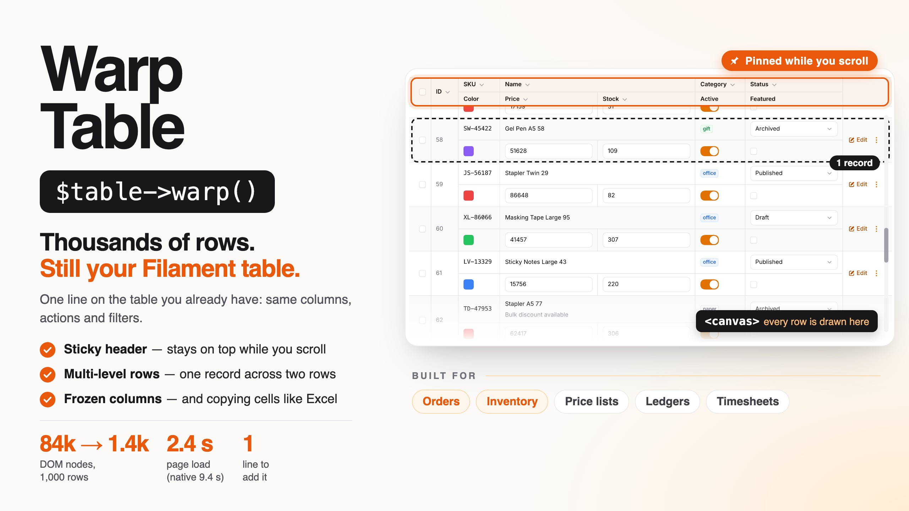
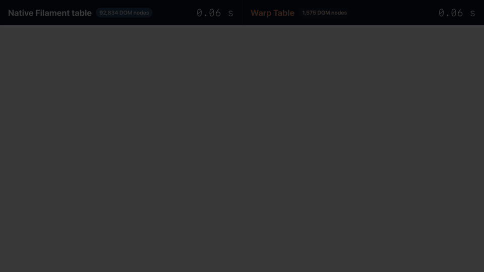
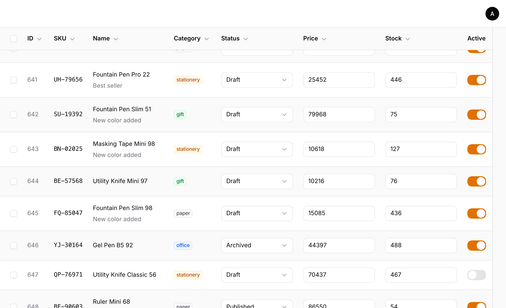
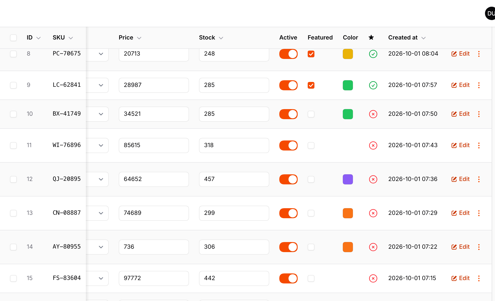
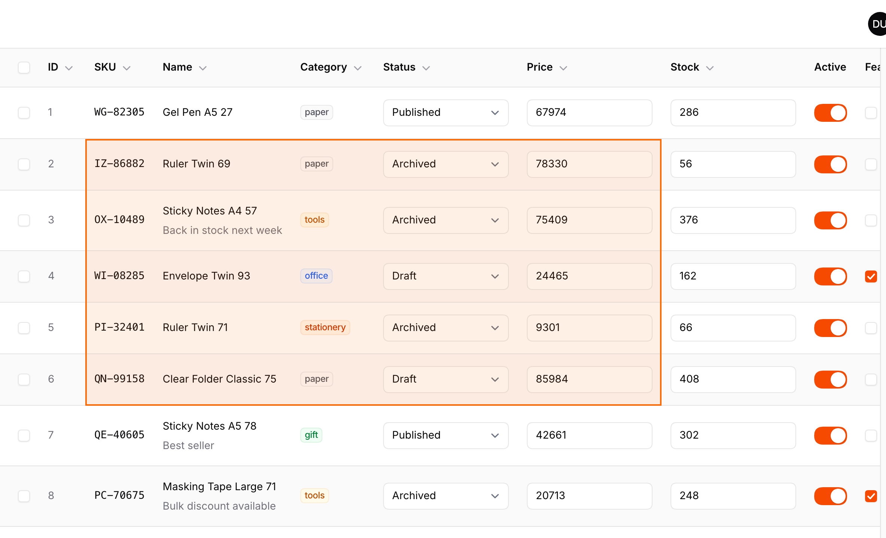

# Warp Table

**Fast Filament tables for large pages: the rows are drawn on a `<canvas>`, with a sticky header and ledger-style multi-level rows that the native table does not have, while everything else behaves exactly like the native table.**

<a href="https://demo.warpui.com/table"></a>

Edit cells, sort, group, select and compare with the native table side by side at **[demo.warpui.com/table](https://demo.warpui.com/table)**. No sign-up needed; the data is reset every hour.

<a href="https://demo.warpui.com/table"></a>

*The same 1,000-row table with editable columns, loaded side by side from an empty cache: the native table on the left, Warp Table on the right (recorded on the demo's Speed Lab page).*

Filament tables slow down once a page holds several hundred rows, and much more so when those rows contain inline-editable columns (`TextInputColumn`, `SelectColumn`, `ToggleColumn`, `CheckboxColumn`). Every cell becomes Blade output and Alpine components, and the browser has to build and lay out tens of thousands of DOM nodes.

Warp Table keeps your existing `Table` definition. Add `->warp()` and the records area is drawn on a canvas. The header toolbar, filters, search, pagination, bulk actions, modals and notifications are still Filament's own. Only the cell you are editing becomes a real `<input>` / `<select>`.

```php
public static function table(Table $table): Table
{
    return $table
        ->warp()
        ->columns([...]);
}
```

## Why

Measured on a demo table with 1,000 rows and 10 columns, 4 of them editable (Chrome, Filament 5):

| | Native table | Warp Table |
| --- | --- | --- |
| HTML sent | 35 MB | 0.7 MB |
| DOM nodes | 83,961 | 1,445 |
| Alpine components | 6,021 | 23 |
| Time to `load` | 9.4 s | 2.4 s |

On a real order-management table (grouped by file, with group subtotals), the native table could not render 2,500 rows per page at all: PHP ran out of memory while rendering the Blade. Warp Table rendered the same page, with 869 groups and 872 summary rows, in about 3.7 s.

## Features

- **Drop-in**: one method, same `Table` definition, same columns, filters, actions and pagination.
- **Behaves like the native table**, verified side by side against Filament's own table:
  - Row links are real links: Cmd/Ctrl-click and middle-click open a new tab, the context menu works, and the URL shows in the status bar.
  - Cell clicks follow the native rules: a column `url()` makes the whole cell a link, a column `action()` runs instead of the row's URL, and `disabledClick()` turns the cell off.
  - Selection, "select all", Shift-click range selection, group checkboxes and bulk actions go through Filament's own selection store.
  - Keyboard: the Tab order, focus rings and Enter / Space behavior match the native table.
  - Page scrolling: the table scrolls with the page, and paging scrolls back to the top of the table.
  - Loading states: checkboxes are disabled and the sort indicator spins while Livewire is busy.
  - Column widths are measured by the browser with the same markup, so columns line up with the native table to the pixel, at every screen width.
  - Phones and tablets: columns hidden with `visibleFrom()` / `hiddenFrom()` follow the screen width, touch scrolling and taps work, and `stackedOnMobile()` tables use Filament's stacked layout on narrow screens.
  - Browser find (Cmd/Ctrl+F) finds text in every row, including rows that are off screen.
  - Screen readers and browser tests read the cells on screen: their text is kept in a hidden table in the page (see [Browser tests and screen recordings](#browser-tests-and-screen-recordings)).
- **Sticky header**: `->warpStickyHeader()` keeps the header row on screen while the page scrolls, so you always know which column you are looking at, even 600 rows down. The native table cannot do this, because its scrolling container stops CSS `position: sticky` from working. It also works inside modals and slide-overs.
- **Frozen columns**: `->warpFrozenColumns(2)` keeps the first columns in view while a wide table scrolls sideways, like frozen columns in a spreadsheet. The native table has no equivalent.
- **Select and copy cells**: `->warpCellSelection()` lets users drag across cells and copy them with Ctrl/Cmd+C, ready to paste into Excel or Google Sheets. The native table cannot copy a block of cells.
- **Entry row**: `->warpEntryRow()` puts an empty row under the header. Type, Tab to the next field, press Enter, and the record is created with your resource's own form, validation and permissions. The native table only has the create page or modal.
- **Sparklines and progress bars**: `SparklineColumn` draws a small line, area, bar or win/loss chart in each row, with the highest, lowest and latest values marked if you like, and `ProgressColumn` a progress bar with a percentage. The shapes are made on the server as SVG, so the native table shows them too.
- **Grouping**: collapsible groups, HTML group titles, group descriptions and group selection.
- **Column groups**: `ColumnGroup` labels above the column headers, with the same dividers as the native table.
- **Summaries**: group subtotals, page summary and table summary, using Filament's summarizers.
- **Multi-level rows**: show each record on several lines, ledger style, with a multi-level header. The native table has no equivalent either.
- **Inline editing**: text inputs and selects are edited in place, and toggles and checkboxes are toggled in place. Validation errors are shown inline, exactly as your column rules return them.
- **Actions**: record actions, action groups (dropdowns), URL actions, modals and confirmations, all using Filament's own action pipeline.
- **Theme aware**: colors, fonts and spacing are read from Filament's CSS at runtime, so custom themes and dark mode work without configuration.
- **Automatic fallback**: in states the canvas does not draw (see below), the regular Filament table is rendered with no change on your side.

## Screenshots

A sticky header that stays below the panel's topbar, 640 rows down a 1,000-row page:



Inline editing, row selection and badges:


Collapsible groups with subtotals and a table summary:


Frozen columns: ID and SKU stay at the left edge while the table scrolls sideways, with a sticky header:



A range of cells selected by dragging, ready to copy into a spreadsheet:



## Requirements

- PHP 8.3+
- Laravel 12 or 13
- Filament 5.10.2 or later (Livewire 4)
- SQLite, MySQL 8.0+, MariaDB 10.11+ or PostgreSQL 14+

Works in panels and in standalone Livewire components that use Filament's Table Builder.

### Tested on

Before each release, the full test suite runs on PHP 8.3, 8.4 and 8.5 × Laravel 12 and 13 × SQLite, MySQL, MariaDB and PostgreSQL, with each database at its newest and its oldest supported version: 42 combinations in all. A version is released only when every combination passes.
[See the results for each release](https://github.com/qalainau-labs/filament-warp-table-docs/tree/main/test-runs).

## Installation

> **Warp Table is a commercial plugin.** A license is required. After purchase you receive credentials for the private Composer repository.

Add the repository and authenticate:

```bash
composer config repositories.qalainau composer https://qalainau.privato.pub/composer
composer config --auth http-basic.qalainau.privato.pub "your-email" "your-license-key"
```

The username is the email address on your license and the password is your license key. Use the same credentials on every machine and server that installs the package, such as your laptop, CI and production.

Install the package and publish Filament's assets:

```bash
composer require qalainau/filament-warp-table
php artisan filament:assets
```

The service provider is auto-discovered. There is nothing else to register.

> Run `php artisan filament:assets` again after every update of the package. The asset URLs contain a hash of the file contents, so browsers pick up the new build immediately.

### AI coding assistants (Laravel Boost)

Warp Table ships instructions for AI coding assistants such as Claude Code, Cursor and Codex. If your app uses
[Laravel Boost](https://laravel.com/docs/boost), the assistant learns how to use Warp Table from them: that `->warp()`
on your existing table is all it takes, which options replace custom code (sticky header, frozen columns, copying
cells), what is easy to get wrong, and how to test a table whose rows are drawn on a canvas.

- **Guidelines** (`resources/boost/guidelines/core.md`): a short summary that Boost adds to `CLAUDE.md`,
  `AGENTS.md` and the other agent files. It also points the assistant to this README in `vendor/`, so it reads the
  documentation of the version you have installed instead of guessing.
- **Skill** `warp-table-development` (`resources/boost/skills/`): the steps for adding Warp Table to a table, where
  validation and customisation go, and how to write feature and browser tests. The assistant loads it when it works on
  a Warp Table.

Boost does not add guidelines of other vendors' packages on its own. When `php artisan boost:install` asks
"Which third-party AI guidelines/skills would you like to install?", select `qalainau/filament-warp-table`. To do
it without the question, add the package to `boost.json` and run the command again:

```json
{
    "packages": ["qalainau/filament-warp-table"]
}
```

```bash
php artisan boost:install --guidelines --skills -n
```

## Usage

Call `->warp()` on any table:

```php
use Filament\Actions\ActionGroup;
use Filament\Actions\DeleteAction;
use Filament\Actions\EditAction;
use Filament\Tables\Columns\CheckboxColumn;
use Filament\Tables\Columns\SelectColumn;
use Filament\Tables\Columns\TextColumn;
use Filament\Tables\Columns\TextInputColumn;
use Filament\Tables\Columns\ToggleColumn;
use Filament\Tables\Table;

public static function table(Table $table): Table
{
    return $table
        ->warp()
        ->columns([
            TextColumn::make('sku')->sortable()->searchable()->copyable(),
            TextColumn::make('name')->description(fn ($record) => $record->note),
            TextColumn::make('category')->badge(),
            SelectColumn::make('status')->options([
                'draft' => 'Draft',
                'published' => 'Published',
            ]),
            TextInputColumn::make('price')->type('number')->rules(['integer', 'min:0']),
            ToggleColumn::make('is_active'),
            CheckboxColumn::make('is_featured'),
        ])
        ->groups(['category'])
        ->recordActions([
            EditAction::make(),
            ActionGroup::make([DeleteAction::make()]),
        ])
        ->paginated([100, 500, 1000]);
}
```

`->warp()` accepts a boolean or a closure, so you can enable it conditionally:

```php
$table->warp(fn (): bool => auth()->user()->prefersFastTables());
```

`$table->isWarp()` tells you whether Warp Table is active for a table.

### Options

```php
$table
    ->warp()
    ->warpInfiniteScroll(100, 2000) // grow the current page while scrolling (default: off)
    ->warpStickyHeader()          // keep the header row on screen while the page scrolls (default: off)
    ->warpFrozenEndColumns(1)     // keep the last column and trailing row actions at the right edge (opt-in)
    ->warpFrozenColumns(2)        // keep the first 2 columns in view while the table scrolls sideways (default: 0)
    ->warpPaste()                 // paste spreadsheet cells and fill down (default: off; enables cell selection)
    ->warpCellSelection()         // select cells by dragging and copy them as a spreadsheet range (default: off)
    ->warpPinnedRows()           // pin records per user and tenant (default: off)
    ->warpHeaderFilters()        // Excel-style filters on marked column headings (after filters())
    ->warpRowDetail(fn (Model $record) => view('products.detail', compact('record'))) // expandable read-only details
    ->warpResizableColumns()     // drag header boundaries to resize columns (default: off)
    ->warpEntryRow()              // an empty row under the header to add records with Enter (default: off)
    ->warpHeight('70vh')          // scroll inside the table with a sticky header (default: scroll with the page)
    ->warpRowHeight(56)           // fixed row height in px (default: computed from the content, like the native table)
    ->warpMeasureSampleSize(300)  // rows measured for column widths, plus the widest rows further down (default: 300)
    ->warpMultiLevel(columns: 6, rows: 2); // several lines per record (see "Multi-level rows")
```

By default the table scrolls with the page, exactly like the native table. `warpStickyHeader()` keeps the page scroll but pins the header row below the panel's topbar until the last record scrolls past, so long tables stay readable. Inside a modal or slide-over, the header sticks to the top of the modal's scrolling area instead. The native table has no equivalent, because its scrolling container stops CSS `position: sticky` from working, so the option is off by default. `warpHeight()` switches to a fixed-height scroll area with a sticky header row. This is useful for dashboards or very long pages.

For a table in a box of fixed height, such as a dashboard widget, use `warpHeight('400px')` rather than CSS `max-height` and `overflow` on a wrapper. Warp Table does not know about a scroll area that your CSS adds, so the header row would scroll away with the rows.

## Frozen columns

A table with many columns scrolls sideways when it is wider than the page. Every Warp table then shades the edge where more columns are hidden — the right edge at first, the left edge once you have scrolled — because macOS and many trackpads hide the scrollbar until you scroll, and the last column would otherwise just look cut off. The columns that tell you which record you are looking at still scroll away with the rest. `warpFrozenColumns()` keeps the first columns in view, like frozen columns in a spreadsheet:

```php
$table
    ->warp()
    ->warpFrozenColumns(2); // the first two columns stay at the left edge
```

- The count is the number of your columns, in the order they are shown. The selection checkboxes and record actions placed before them (`recordActionsPosition(RecordActionsPosition::BeforeColumns)`) are frozen with them.
- A thin shadow marks the edge while the table is scrolled sideways. The header row, group headers, group checkboxes and summary rows stay aligned with the frozen columns, and group titles and their collapse buttons stay in view.
- Clicking, links, inline editing and the dropdowns work in the frozen columns as usual. Tab and Shift+Tab scroll the table sideways to the focused cell, so a field never ends up hidden under the frozen columns.
- Works together with `warpStickyHeader()` and `warpHeight()`.
- Nothing is frozen when the table fits the page, when the frozen columns would take more than two thirds of the width the table is shown in (on small screens, or in a narrow box such as a Split View pane or a modal), and for multi-level rows. It accepts a closure too.

The native table has no equivalent, so when Warp Table falls back to the native table (see *Automatic fallback*), the columns simply scroll.

Keep columns at the right edge with `warpFrozenEndColumns()`:

```php
$table
    ->warpFrozenColumns(2)
    ->warpFrozenEndColumns(1); // last user column and trailing row actions
```

The first argument counts user columns from the end of the visible order (default `0`, negative values become `0`). The second argument, `actions` (default `true`), also freezes the row actions when their position is `AfterColumns` or `AfterCells`. Call `->warpFrozenEndColumns()` with no arguments to freeze only those actions, or `->warpFrozenEndColumns(1, actions: false)` to freeze only the last user column. Both arguments accept closures. Without this call, nothing is frozen at the right edge.

The right boundary casts a light shadow only while more content is hidden toward the right. Headers, sticky headers, summaries, column searches and the entry row follow the frozen columns.

How much may be frozen:

- Start and end freezing together may take up to two thirds of the width the table is shown in. That is the table's own visible width, not the browser window: inside a Warp Split View list pane, a modal, a slide-over or a narrow grid column, the two thirds are measured on that box.
- Start freezing takes priority. When the limit is exceeded, end columns are dropped starting from the one nearest the scrolling area, so the row actions (the outermost) stay frozen longest.
- The limit is measured again whenever the box changes width: resizing the window, dragging the Split View divider, or opening and closing a sidebar.
- Tables that fit their box, multi-level layouts and the native table on narrow screens do not freeze end columns.

In a narrow box, row actions with text labels can take most of the two thirds on their own. For example, in a 385 px Split View pane up to about 256 px may be frozen, and three text buttons (about 230 px) fit, leaving roughly 150 px for the scrolling columns. To keep more of the record visible there, show the actions as icon buttons (`->iconButton()` with a `->tooltip()`), or freeze only your columns with `->warpFrozenEndColumns(1, actions: false)`.

## Resizing columns

`warpResizableColumns()` lets each person drag the right boundary of a column heading to set its width. Double-click the boundary to remove that override and return to the current measured width. Widths apply from the first draw and stay aligned with frozen columns, sticky headers, column searches, entry rows, group headings and summaries.

```php
$table
    ->warp()
    ->warpResizableColumns(condition: true, remember: true)
    ->warpPreferencesKey('orders'); // optional; accepts a closure
```

Both `condition` and `remember` accept booleans or closures and default to `true`. With `remember: false`, widths last for the current table view and reset on a page reload. With remembering enabled, signed-in users save widths in the database, separately for each user, tenant and table. Guests use their browser's localStorage instead. The default table key is the Livewire class name, plus the relationship name for a relation manager; `warpPreferencesKey()` overrides it.

Publish and run the optional migrations before enabling database persistence:

```sh
php artisan vendor:publish --tag=filament-warp-table-migrations
php artisan migrate
```

This publishes two migrations, which run in order: `add_warp_table_preferences_table` creates the `warp_table_preferences` table, and `add_tenant_type_to_warp_table_preferences_table` (1.6.1) gives it the same two tenant columns as the other Warp plugins, `tenant_type` and `tenant_id`. If you published the migration with 1.6.0, run the same two commands again after updating: only the new migration is published. Until it runs, Warp Table keeps reading and writing the 1.6.0 columns. The new migration keeps every saved width and pin. When your panels use a single tenant model, it also fills in the tenant type of the existing rows; with several tenant models, rows saved by 1.6.0 stay readable for the tenant with that key until the user saves again.

Migrations never run automatically. A missing preferences table produces an error with these commands only when a signed-in table uses persistence. Tables without resizing do not read preferences or load the resizing JavaScript. No tenant is stored as empty strings in both tenant columns, so the database enforces uniqueness consistently.

Only ordinary data columns can be resized. Selection checkboxes, record action columns, multi-level tables and the native table fallback are excluded. Widths are stored as pixels by column name. The server discards unknown or hidden columns and nonnumeric values, converts numeric values to integers, clamps them to 48–1600px, and accepts at most 200 overrides. Resetting a column removes its saved override. Saving happens once when dragging ends and skips the Livewire render; an open action modal defers the save until it closes.

### Pinned rows

Keep frequently used records at the top of a list for each signed-in user:

```php
$table->warp()->warpPinnedRows();
$table->warpPinnedRows(condition: fn () => true, max: 20);
```

`condition` accepts a boolean or closure (default `true`); `max` accepts an integer or closure (default `20`). New pins are saved first and the oldest pins are dropped when the limit is reached. Pinned rows are listed in that order: the latest pin first. The **Pin to top** / **Unpin** record action is appended automatically, regardless of whether `recordActions()` is called before or after `warpPinnedRows()`. You may place `Qalainau\FilamentWarpTable\Actions\WarpPinAction::make()` yourself, including inside an action group; it will not be added twice.

Preferences use the optional `warp_table_preferences` table, with kind `pinned_rows`, scoped by user, table and tenant. Publish and run its migrations (the same two migrations used for column widths, see [Resizing columns](#resizing-columns)):

```bash
php artisan vendor:publish --tag=filament-warp-table-migrations
php artisan migrate
```

`warpPreferencesKey()` overrides the default table identity (Livewire class plus relationship name for relation managers). Guests cannot pin records. Actions resolve the record through Filament's table query and record key, including tenant scopes; supplied argument IDs are ignored. Deleted or inaccessible records never appear. Search and filters still apply.

Pins receive a subtle background and a pin indicator. Later pages prepend copies of pinned records absent from that page. These copies cannot be selected and do not change pagination totals, summaries or select-all records; original records remain in the normal query. During grouping, pins keep their indicator, but neither pin ordering nor copies are applied. Pin ordering and copies are also suspended during reordering.

### Header filters

Add an Excel-style funnel to selected column headings. Header filters use one real Filament filter named `warpHeader`, so existing filters, search and tenant scopes continue to apply. Date-time columns filter by calendar dates in the panel timezone (or the column timezone when set).

```php
use Filament\Tables\Columns\TextColumn;

$table
    ->warp()
    ->columns([
        TextColumn::make('category')->warpHeaderFilter(),
        TextColumn::make('price')->numeric()->warpHeaderFilter(),
        TextColumn::make('created_at')->date()->warpHeaderFilter(),
        TextColumn::make('status')->warpHeaderFilter(options: [
            'draft' => 'Draft',
            'published' => 'Published',
        ]),
    ])
    ->filters([/* your existing Filament filters */])
    ->warpHeaderFilters();
```

`Column::warpHeaderFilter(string|Closure|null $type = null, array|Closure|null $options = null)` marks a column. Types are `values` (checkbox list), `range` (inclusive numeric bounds) and `dates` (inclusive calendar dates). When omitted, number inputs and numeric text columns infer `range`, date/date-time text columns infer `dates`, and other columns infer `values`. Options are a `[value => label]` array or a closure evaluated with the column's normal dependencies. Relationship columns using dot notation and calculated columns require explicit options. Relationship filters use `whereHas`; calculated states must still refer to queryable database attributes.

Call `warpHeaderFilters()` **after `filters()`**, because Filament replaces filters in `filters()`. Columns may be defined before or after `warpHeaderFilters()`. Missing registration or overwritten filters produce an explanatory exception. A table without marked columns adds no visible filter or feature payload.

Automatic value lists show each value as the column displays it (`formatStateUsing()`, enum labels), and so do the indicators; the stored value is used when a formatter needs the record. Values load only when opening the popover or searching its list, through the hidden `warpHeaderFilterOptions` action. Automatic lists use the filtered table query with only that column's own header filter excluded: other column filters, normal Filament filters, search and tenant constraints remain. The distinct query fetches at most 201 values, displays at most 200 and asks the user to narrow the search when more exist. Supplied options use the same display limit; scope any options-query closure to your tenant as you would for a normal Filament options closure. Rendering never fetches the automatic list. Blank selection includes SQL NULL and empty strings. Applying or clearing uses one `warpSetHeaderFilter` request, validates state, resets pagination and deselects records according to Filament settings. At most 500 values are accepted.

State lives in `tableFilters.warpHeader.<column>` and its deferred counterpart. Filament's remove-all control and each column's removable indicator clear these filters; `persistFiltersInSession()` also restores them. With only header filters, the empty standard filter panel trigger is hidden. If other Filament filters exist their panel stays available. The popover supports keyboard navigation, Escape, outside-click dismissal and focus return.

Tables using `records()` with array data are excluded: column marks are ignored. The native table fallback on narrow screens does not show header funnels; Filament filters and their indicators still apply. No extra feature script, payload keys or value-list queries are added to tables that do not use header filters.

### Filtering with AI

`WarpAiFilterAction` fills existing header filters from a sentence such as “published products under 5,000 created this month”. It is off by default: explicitly add the action to `headerActions` on a table with marked `->warpHeaderFilter()` columns and `->warpHeaderFilters()`. Tables without this action keep their existing HTML, payload, queries, assets and Livewire requests.

```php
use Qalainau\FilamentWarpTable\Actions\WarpAiFilterAction;

$table->headerActions([
    WarpAiFilterAction::make()->using(
        fn (string $prompt, array $schema): array|string => $yourAiResolver($prompt, $schema),
    ),
]);

// Alternatively, use Laravel HTTP (no AI SDK required):
WarpAiFilterAction::make()->anthropic(config('services.anthropic.key'));
WarpAiFilterAction::make()->openAi(config('services.openai.key'), 'your-model');
WarpAiFilterAction::make()->openAi(config('services.ai.key'), 'your-model', 'https://your-gateway.example/v1');
```

The modal's note names where the text goes: `anthropic()` and `openAi()` set it to Anthropic and OpenAI; with `using()`, it says "your AI provider" (translated) unless you name it with `->provider('Acme AI')`. `anthropic()` defaults to `claude-haiku-5-5`. Built-in requests time out after 20 seconds; keys are sent only in headers. Configure keys in your application's secret configuration. When neither a resolver nor `warp.ai` is available, opening the action produces the same explanatory exception. Provider failures show a notification and preserve the current filters.

The plugin builds an English prompt and accepts user text in English or Japanese. The resolver receives the complete prompt and a schema and returns an array or JSON string shaped as:

```json
{"filters":{"status":{"values":["Published"]},"price":{"max":4999},"created_at":{"from":"2026-11-01","until":"2026-11-30"}},"clear":["category"]}
```

Only marked columns and fields matching their type are accepted: `values` / boolean `blanks`, numeric `min` / `max`, or date `from` / `until`. Values must match labels in the list sent to the provider; supplied option labels map back to their underlying filter values. Unknown columns, values and invalid fields are discarded. AI only fills values and never writes SQL. Applied filters appear in Filament's removable indicators and reset pagination. If nothing can be applied, a notification appears and existing filters stay unchanged.

Data sent to the provider:

- Each marked column's name, label and type (`values`, `range` or `dates`).
- For `values` columns, the supplied `$options` labels, or up to 100 distinct values from the table query, including tenant constraints. Lists are capped at 100. Scope supplied options closures to the tenant, as for ordinary header filters.
- Today's date in the panel's Filament timezone.
- The user's sentence (at most 500 characters).

Record rows, other columns' values, and the user's name or email are not sent. The modal displays a disclosure of the provider and data sent. `->sendValues(false)` omits all value lists and sends column labels/types/names, today's date and the sentence; without a list, AI cannot select values (blank selection, ranges, dates and clearing still work). Any sensitive information typed into the sentence is part of that sentence.

Normal Filament action authorization and visibility apply. Explicit resolvers are limited to 10 requests per user per minute across tables (guests share the limit within their session). Gateway requests are counted and limited by the gateway, without a second plugin limit. No AI requests happen until the user submits the modal.

#### Which AI service is used

`WarpAiFilterAction` uses the first available source:

1. **An explicit `using()`, `anthropic()` or `openAi()`**: your existing resolver or HTTP adapter always takes precedence, even when a gateway is bound.
2. **An AI gateway bound to `warp.ai`**: [Warp SaaS](https://warpui.com) binds one for you and chooses the model, counts requests per company, person and feature, and enforces plan limits. Without Warp SaaS, write your own gateway (below).
3. **Neither**: the action keeps its existing appearance and throws the explanatory configuration exception when opened. The action is never added automatically.

With a gateway, add the action without a resolver. `aiFeature()` optionally names the usage meter; without it, the gateway counts `table.filter`. It accepts a string or closure; empty names are ignored. Existing resolvers ignore this setting.

```php
$table->headerActions([
    WarpAiFilterAction::make()->aiFeature('product_search'),
]);
```

Before enabling the button, the action asks `unavailable()` once per Action object, including when the answer is `null`. A sentence disables the button, becomes its tooltip, and appears as a small note below the button. Direct mount and submit calls are also refused with that sentence. If `ask()` throws an exception with a nonempty `userMessage()`, the user sees that sentence (trimmed and limited to 300 characters); otherwise, a translated failure notification appears and the exception is reported. Existing filters stay unchanged on failure.

The gateway receives the column information and sentence listed above, with instructions separate from the user's input and a JSON schema for `filters` and `clear`. Every column and field is required in that schema, and an empty list, `false` or an empty string means “no suggestion” (the schema has no `null` union types, because models limit how many of those a schema may have and a table with many filter columns would be refused); range bounds come back as numbers written as text. `clear` explicitly removes a column's filter. Responses go through the same column, option, number and date checks as existing resolvers. `sendValues(false)` omits lists from both instructions and schema enums and prevents selecting unsent values. The gateway also receives the current Filament tenant, authenticated user and app locale to authorize and count usage; it decides which context to pass to the external AI provider. The modal names “the AI service this app uses”, or your explicit `provider('…')` label.

**Writing your own gateway.** This example uses Laravel's HTTP client with structured output, as in Warp Input. Put the class in `app/Ai/AiGateway.php` (namespace `App\Ai`) and choose the provider and models in your app:

```php
use Illuminate\Support\Facades\Http;
use RuntimeException;

class AiGateway
{
    public function ask(array $request): array
    {
        $response = Http::timeout(90)
            ->withHeaders(['x-api-key' => config('services.anthropic.key'), 'anthropic-version' => '2023-06-01'])
            ->post('https://api.anthropic.com/v1/messages', [
                'model' => $request['tier'] === 'smart' ? 'claude-sonnet-5-5' : 'claude-haiku-5-5',
                'max_tokens' => $request['max_output_tokens'] ?? 2000,
                'system' => $request['instructions'],
                'output_config' => ['format' => ['type' => 'json_schema', 'schema' => $request['schema']]],
                'messages' => [['role' => 'user', 'content' => $request['input']]],
            ])
            ->throw();

        $text = collect($response->json('content'))->firstWhere('type', 'text')['text'] ?? '';
        $data = json_decode($text, true);

        return is_array($data) ? ['data' => $data] : throw new RuntimeException('No answer.');
    }
}

// app/Providers/AppServiceProvider.php, in register()
$this->app->singleton('warp.ai', \App\Ai\AiGateway::class);
```

Optionally add `unavailable(array $request): ?string` (a sentence to disable, `null` to allow). Exceptions may provide `userMessage(): string` to show a safe refusal. The plugin does not depend on an AI SDK or another Warp plugin.

**Moving from direct HTTP adapters.** `anthropic()` and `openAi()` are deprecated: they keep working in 1.x and will be removed in 2.0. Bind `warp.ai` and remove the explicit adapter call so the action uses your gateway. A custom `using()` remains supported and still wins; replace a resolver that only counts usage with `aiFeature('…')` once your gateway counts it. Existing HTTP request bodies, disclosure text and HTML without a gateway are unchanged.

### Row details

Use row details to show secondary information beneath a record without adding more columns:

```php
use Illuminate\Database\Eloquent\Model;

$table
    ->warp()
    ->warpRowDetail(
        fn (Model $record) => view('products.detail', ['record' => $record]),
        condition: true,
    );
```

`warpRowDetail(Closure $content, bool|Closure $condition = true)` adds a narrow toggle column after the selection checkbox and before your columns. Click the arrow or press Enter or Space to expand it. The content closure receives the resolved record and returns a Blade View, an `Htmlable`, or a string. Strings are escaped; Views and `Htmlable` provide HTML, so use Blade escaping for untrusted values.

Opening an uncached record makes one Livewire request through the hidden `warpRowDetail` action, without rendering the table again. HTML is cached in the browser by record key. A changed row payload invalidates it and reloads an open detail. Expansion survives sorting and Livewire redraws while that key remains; changing the pagination page closes details. The measured band follows the viewport width when scrolling horizontally, and height changes (including image loads) reposition subsequent rows and summaries.

Content supports read-only HTML and links. Livewire components, forms, `wire:` attributes and interactive Alpine components inside it are unsupported. Record resolution uses Filament's table query, filters and tenant scope; inaccessible or missing records return no content. Scope your table query to records the user may view, and authorize sensitive fields inside your content closure as you would in any other View. A false condition disables the feature. Details are unavailable with `warpMultiLevel()` and when the table falls back to Filament's native table on narrow screens.

### Reserved action names

`warpAiFilter` is reserved for the AI header action.

`warpPin` is reserved for the pinned-row record action.

`warpHeader` is reserved for the header filter. `warpHeaderFilterOptions` and `warpSetHeaderFilter` are reserved internal table actions.

`warpEntryRow`, `warpSaveColumnWidths` and `warpRowDetail` are internal table actions. Do not give your own actions names starting with `warp`; that prefix is reserved for Warp Table features.

## Selecting and copying cells

Rows on a canvas cannot be selected like text, and even in the native table, selecting text across rows copies a jumble of labels instead of cells. `warpCellSelection()` makes the records area work like a spreadsheet range instead:

```php
$table
    ->warp()
    ->warpCellSelection();
```

| Action | Result |
| --- | --- |
| Drag across cells | Selects the range. The page and the table scroll when you drag to an edge. |
| Click a cell that does nothing on click | Selects that cell. |
| Shift+click, Shift+arrow keys | Extend the range. |
| Arrow keys | Move the selected cell. |
| Ctrl/Cmd+A | Select every cell of the page (while the table has focus). |
| Ctrl/Cmd+C, or Copy in the browser menu | Copy the range as tab-separated text and as an HTML table, ready to paste into Excel, Numbers or Google Sheets. |
| Escape, or a click outside the table | Clear the range. |

- Clicks keep working as usual: a click without moving the mouse still follows links, opens inline editors, copies `copyable()` text and runs column actions. Only a drag to another cell selects instead, so it never opens a record by accident. Checkboxes, toggles, sort buttons and record actions never start a range.
- Cells are copied as they are shown: the text of text columns (without descriptions), the value of text inputs, the label of select options, `TRUE` / `FALSE` for toggles and checkboxes, the tooltip of icons, the URL of images, the color of color columns and the text of other columns. Rows of collapsed groups are skipped.
- The range is kept across Livewire updates, for example after editing a cell or hiding another column, as long as its records and columns are still on the page. It works with `warpFrozenColumns()`, `warpStickyHeader()` and `warpHeight()`.
- While the option is on, links in the rows can no longer be dragged to the browser's tab bar, because dragging selects cells. It is not available for multi-level rows.

## Pasting from a spreadsheet

For small edits copied from Excel or Google Sheets, enable pasting separately from copying:

```php
$table
    ->columns([
        TextInputColumn::make('price')->rules(['required', 'numeric', 'min:0']),
        SelectColumn::make('status')->options(['draft' => 'Draft', 'published' => 'Published']),
        ToggleColumn::make('is_active'),
    ])
    ->warp()
    ->warpPaste(maxCells: 200);
```

`warpPaste(bool|Closure $condition = true, int|Closure $maxCells = 200)` automatically enables cell selection when active. `warpCellSelection()` alone still only selects and copies; it does not enable pasting. The paste module is loaded only for tables that enable it. Multi-level rows are not supported.

Select a cell or drag a range, focus the table and press Ctrl/Cmd+V. Tab-separated `text/plain` supports quoted tabs, newlines and escaped quotes. Values start at the selection's top-left. A single value fills the whole selected range; a smaller source rectangle repeats across a larger selection. Ctrl/Cmd+D copies the selection's first row into the rows below it. Input editors retain their normal paste and keyboard behavior.

Only `TextInputColumn`, `SelectColumn`, `ToggleColumn` and `CheckboxColumn` receive values. Read-only cells, disabled rows, collapsed rows and unmatched options are skipped and counted in one final Filament notification. Hidden columns keep their destination slots and are skipped and counted without receiving values. Selects match option values first, then labels, without case sensitivity, using the options available for that cell. Toggles and checkboxes accept `1` / `0`, `true` / `false`, yes / no in the ten table languages (`yes` / `no`, `はい` / `いいえ`, `ja` / `nein`, `oui` / `non`, `sí` / `no`, `sì` / `no`, `sim` / `não`, `예` / `아니요`, `是` / `否`), and the TRUE / FALSE that Excel copies in German, French, Spanish, Italian and Portuguese (`WAHR` / `FALSCH`, `VRAI` / `FAUX`, `VERDADERO` / `FALSO`, `VERO` / `FALSO`, `VERDADEIRO` / `FALSO`), regardless of letter case, of full-width letters and digits typed with a Japanese input method (`ＴＲＵＥ`, `１`) and of the current app language. Other values are skipped and counted as unmatched.

Each cell saves sequentially through Filament's existing `updateTableColumnState`, with the same column validation, disabled/permission checks and tenant-scoped record resolution as inline editing. Configure permission restrictions on editable columns as usual. Each saving cell uses the usual pending indicator; validation errors keep the usual cell error indicator and message. Changes are immediate and partial successes remain saved if another cell fails. A range pasted while the previous paste is still saving waits and is then applied to the range that was selected when it was pasted (up to 20 waiting pastes). If the reply of a save never arrives, the cell is not counted as saved: the table reloads and the notification says how many cells could not be confirmed. There is no Ctrl+Z or undo.

The default limit is 200 destination cells, including skipped cells, with a hard maximum of 1,000. A paste over the limit saves nothing. Values beyond the current page or last visible column are skipped; pasting never creates records. Use Warp Sheet for large editing sessions and spreadsheet workflows; this option is intended for small updates to existing table records.

## Entry row

People who add many short records, such as products, prices or time entries, should not have to open a form for each one. `warpEntryRow()` puts an empty row right under the header, with a field for each column:

```php
$table
    ->warp()
    ->warpEntryRow();
```

| Action | Result |
| --- | --- |
| Type, then Tab / Shift+Tab | Moves between the fields of the row. |
| Enter | Creates the record. The row is emptied and the first field gets the focus again, ready for the next one. |
| Esc | Clears the row. |

- **The record is created by Filament's own `CreateAction`** (named `warpEntryRow`). On a resource's list page it uses the resource's `form()`, the `create` permission of your policy (`canCreate()`), the tenant of the panel and the success notification, exactly like the "New" button. In a relation manager, the record is created through the relationship.
- **Which fields are in the row**: every column whose name is a field of the form. `TextInput` (text, number, email, phone, URL), `Textarea`, `Select` (one value, with options that can be listed), `Toggle`, `Checkbox`, `DatePicker` and `DateTimePicker` get a field; other fields, such as file uploads or selects that search the server, are left out. Choose the columns yourself with `warpEntryRow(columns: ['sku', 'name', 'price'])`.
- **Validation** runs the rules of the form. When a value in the row is wrong, its message is shown under the field and nothing is saved.
- **Required fields that are not in the table**: when the form has a required field that the row does not show (or another field outside the row fails validation), Enter opens the create modal with the values you typed, so you can fill in the rest there. Nothing is saved until the modal is submitted.
- **Fields that are left empty** get the form's `default()` values.
- **Dates and times** are typed in the browser's date and time fields, in the field's `timezone()` (the panel's timezone by default), and saved like the same value typed in the modal.
- The row is not shown to people who cannot create records, when the form cannot be built, for multi-level rows, and when Warp Table falls back to the native table. Bulk pasting is not part of it; that is what a spreadsheet editor is for.

### Customising the action

The third argument receives the action, so you can change it like any Filament action:

```php
use Qalainau\FilamentWarpTable\EntryRow\WarpEntryRowAction;

$table->warpEntryRow(action: fn (WarpEntryRowAction $action) => $action
    ->successNotification(null)                     // no notification for each new row
    ->mutateDataUsing(fn (array $data): array => [...$data, 'created_by' => auth()->id()]));
```

On a custom page or in a standalone Livewire table, there is no resource to take the form and the permission from. Give them to the action yourself:

```php
$table->warpEntryRow(action: fn (WarpEntryRowAction $action) => $action
    ->model(Product::class)
    ->schema([
        TextInput::make('sku')->required(),
        TextInput::make('price')->numeric()->required()->minValue(0),
    ])
    ->authorize(fn (): bool => auth()->user()->can('create', Product::class)));
```

Do not call `fillForm()` or `mountUsing()` on the action: they would replace the step that puts the typed values into the form.

### Security

- The browser sends the typed values to Filament's `mountAction('warpEntryRow', ...)`. Only the values of the fields shown in the row are put into the form; any other key, such as `id` or `team_id`, is dropped, and values that are not text, numbers or booleans are ignored. The values then go through your form's validation, so a `Select` only accepts its own options.
- Calling the Livewire method directly does nothing for people the action is hidden from (no `create` permission), and for tables without `warpEntryRow()`.
- In a panel with tenancy, the new record is attached to the current tenant by Filament, as with the "New" button.

## Sparklines and progress bars

Two column types draw a small chart in each row. The shapes are made on the server as SVG paths: Warp Table draws them on the canvas, and the native table (`->warp(false)` or a fallback) shows the same SVG, so the columns work in any Filament table.

```php
use Qalainau\FilamentWarpTable\Columns\ProgressColumn;
use Qalainau\FilamentWarpTable\Columns\SparklineColumn;

SparklineColumn::make('sales')
    ->data(fn (Customer $record): array => $record->monthly_sales) // oldest first
    ->highlightMax()
    ->highlightMin()
    ->highlightLast(),

ProgressColumn::make('done_tasks')
    ->maxValue(fn (Project $record): int => $record->tasks_count),
```

### `SparklineColumn`

| Method | Default | What it does |
| --- | --- | --- |
| `data(array \| Closure)` | the column's state | The values, oldest first. Without `data()`, the column's state is used (an array or a collection, for example a JSON column cast to `array`). Values that are not numbers are skipped. |
| `line()`, `area()`, `bar()`, `winLoss()` | `line()` | The kind of chart. `area()` fills under the line. `bar()` draws bars from zero, down for negative values. `winLoss()` draws an up bar for every value above zero, a down bar below zero and a thin bar for zero, all of the same size. |
| `color(string \| array \| Closure)` | `primary` (`success` for `winLoss()`) | The color of the line and the bars: a Filament color name or a `Color::*` array. A closure receives `$state` (the values) and `$record`, for example `fn (array $state) => end($state) >= $state[0] ? 'success' : 'danger'`. |
| `negativeColor(...)` | `danger` | The color of the bars below zero. |
| `highlightMax(condition, color)` | off, `success` | Marks the highest value with a dot (a colored bar for bar charts). |
| `highlightMin(condition, color)` | off, `danger` | Marks the lowest value. |
| `highlightLast(condition, color)` | off, the chart's color | Marks the latest value. |
| `chartSize(width, height)` | 96 × 28 | The size of the chart in pixels. |

`placeholder()` is shown when there are no values, and `tooltip()` receives the values as `$state`. The colors follow dark mode like `IconColumn`. When cells are copied (`warpCellSelection()`) and for screen readers, the cell reads as its values, separated by commas.

### `ProgressColumn`

| Method | Default | What it does |
| --- | --- | --- |
| `maxValue(int \| float \| Closure)` | 100 | The value of 100%. The bar shows the column's state divided by it. A closure receives `$record`. With 0 or `null`, the cell shows the placeholder. |
| `color(string \| array \| Closure)` | `primary` | A closure receives `$state` and `$percentage` (0 to 100 or more), for example `fn (?float $percentage) => $percentage < 20 ? 'danger' : 'success'`. |
| `percentageLabel(bool)` | on | Shows the percentage next to the bar, in the panel's language (one decimal below 10%). |
| `barWidth(int)` | 96 | The length of the bar in pixels. |

Values above the maximum fill the bar and keep their percentage (for example "125%"); values below zero show an empty bar. `max()` is not used for the maximum because Filament's columns already have `max()` for relationship aggregates.

### Load the values of the whole page at once

`data()` runs once for each row. A closure that runs its own query, such as `fn ($record) => $record->orders()->...->get()`, sends one query per row, 1,000 queries for a page of 1,000 rows. Load the values for the whole page in one query instead, and read them in `data()`:

```php
use Illuminate\Database\Eloquent\Builder;
use Illuminate\Support\Facades\DB;

public function table(Table $table): Table
{
    return $table
        ->warp()
        ->columns([
            TextColumn::make('name'),
            SparklineColumn::make('sales')
                ->data(fn (Customer $record): array => $this->monthlySales()[$record->getKey()] ?? []),
        ]);
}

/**
 * The sales of the last 12 months of every customer on the page, in one query.
 *
 * @return array<int, array<int, float>>
 */
protected function monthlySales(): array
{
    return $this->monthlySales ??= (function (): array {
        $ids = $this->getTableRecords()->modelKeys();
        $months = collect(range(11, 0))->map(fn (int $ago): string => now()->subMonthsNoOverflow($ago)->format('Y-m'));

        $rows = DB::table('orders')
            ->selectRaw("customer_id, strftime('%Y-%m', ordered_at) as month, sum(total) as total") // DATE_FORMAT() on MySQL
            ->whereIn('customer_id', $ids)
            ->where('ordered_at', '>=', now()->subMonthsNoOverflow(11)->startOfMonth())
            ->groupBy('customer_id', 'month')
            ->get()
            ->groupBy('customer_id');

        return collect($ids)->mapWithKeys(fn (int $id): array => [
            $id => $months->map(fn (string $month): float => (float) ($rows[$id] ?? collect())->firstWhere('month', $month)?->total)->all(),
        ])->all();
    })();
}

protected ?array $monthlySales = null;
```

- The query runs once per request for the records of the current page (`getTableRecords()`), after search, filters, sorting and tenancy are applied. Months without orders become 0, so every row has 12 values.
- For a value that is already on the record, such as a progress bar, no extra query is needed. When the value comes from a relationship, use a Filament aggregate on the column (`ProgressColumn::make('tasks_done_count')->counts(['tasks as tasks_done_count' => fn (Builder $query) => $query->whereNotNull('done_at')])`) or `withCount()` in `modifyQueryUsing()`.
- A stored summary, such as a JSON column with the last 12 months that a job updates every night, is the fastest: `data()` then reads the attribute, and nothing is computed while the page loads.

## Multi-level rows

Wide records are easier to read when each record spans several lines, like a paper ledger. `warpMultiLevel()` lays the columns out on a grid: every record gets the same number of lines, and each column is placed on the grid with `warpCell()`.

```php
use Qalainau\FilamentWarpTable\MultiLevel\HeaderCell;

$table
    ->warp()
    ->warpMultiLevel(columns: 6, rows: 2, header: [
        HeaderCell::make('ID')->row(1)->col(1)->rowSpan(2)->column('id'),
        HeaderCell::make('Product')->row(1)->col(2)->colSpan(3),
        HeaderCell::make('Price')->row(2)->col(2)->column('price'),
        // ...
    ])
    ->columns([
        TextColumn::make('id')->sortable()->warpCell(row: 1, col: 1, rowSpan: 2),
        TextColumn::make('sku')->warpCell(row: 1, col: 2),
        TextColumn::make('name')->warpCell(row: 1, col: 3, colSpan: 2),
        TextInputColumn::make('price')->sortable()->warpCell(row: 2, col: 2),
        TextInputColumn::make('stock')->warpCell(row: 2),
        // ...
    ]);
```

- `warpCell(row, col, rowSpan, colSpan)` places a column (1-based). If you give only `row`, the column takes the first free place on that line. Columns without `warpCell()` fill the remaining free places line by line, like CSS Grid auto-placement. Extra lines are added when the grid is full.
- `header` is optional. Without it, each column's label is shown at the column's position. A `HeaderCell` linked to a column with `->column('name')` sorts that column and shows its sort icon. `->alignment()` is supported.
- `bordered: false` removes the lines between the columns of the grid. The lines between the lines of a record stay.
- The selection checkbox and the record actions span the full height of the record.
- `warpRowHeight()` sets the height of each line instead of the whole record.
- Summaries are placed under their columns. Lines without any summary are left out of the summary row.
- The column widths of the grid are computed from the content, the same way as in the regular layout.
- Editing, links, selection, grouping and the keyboard work the same as in the regular layout. Tab moves through the cells in reading order (line by line).

Multi-level rows are a Warp Table layout. When Warp Table is disabled or falls back to the native table (see *Automatic fallback*), the table is shown with one line per record.


## Supported columns

| Column | Rendering |
| --- | --- |
| `TextColumn` | Text, lists, badges, colors, icons, weight, font family and size, descriptions, `wrap()`, `limitList()`, `copyable()`, `url()`, `action()`, placeholders. `numeric()` and `money()` use tabular figures. |
| `IconColumn` | Icons, `boolean()`, colors, line breaks, `url()`. |
| `ImageColumn` | Images (lazy-loaded), circular or square, stacked, limit with a remaining count, `url()`. |
| `ColorColumn` | Swatches, copyable, `url()`. |
| `TextInputColumn` | Drawn on the canvas, edited in a real `<input>`. Prefix and suffix labels and icons (with their colors), inline prefixes and suffixes, `mask()`, validation errors. |
| `SelectColumn` | Drawn on the canvas. A native select is edited in a real `<select>` (grouped options are supported). `native(false)` and `searchableOptions()` columns open Filament's own select, with search, server-side search results and relationships. |
| `ToggleColumn` | On/off colors and icons. |
| `CheckboxColumn` | Standard checkbox. |
| `SparklineColumn`, `ProgressColumn` | Warp Table's own columns (see [Sparklines and progress bars](#sparklines-and-progress-bars)). Drawn on the canvas from the same SVG shapes the native table shows. |
| Anything else | The column's regular HTML is rendered as a DOM overlay for the rows currently on screen, for example `ViewColumn`, HTML or Markdown `TextColumn`, third-party columns, and any column whose view was replaced with `->view()` (also a `TextColumn` or `IconColumn`). |

Row classes from `->recordClasses()` are supported. Background colors, text colors and opacity that your CSS assigns to those classes (for example `tr.is-overdue > td { background: … }`) are applied to the canvas rows.

Column `extraAttributes()`, `extraCellAttributes()`, `extraInputAttributes()` and `extraImgAttributes()` work like in the native table. Their classes and styles count when the column widths are measured, so `->extraAttributes(['style' => 'min-width: 6rem'])` widens the column. Their effect on the cell is drawn on the canvas: background, padding, text color, weight, italics, text decoration, alignment and opacity. Other CSS, such as borders or shadows, is not drawn.

Columns with `searchable(isIndividual: true)` get Filament's own search field in a row under the column headers, as in the native table. Typing updates `tableColumnSearches` with the table's search debounce (or on blur with `searchOnBlur()`), the column widths make room for the fields, and the fields scroll sideways with their columns, follow the columns you show or hide, and stay under the header with `warpStickyHeader()` and `warpHeight()`.

## Keyboard

The Tab order is the same as the native table: the page checkbox, then sortable headers, then per group the group checkbox and the collapse button, then per row the row checkbox, cell links and cell buttons (column or row actions), editable cells and actions. Tab leaves the table at either end.

- **Space**: toggles checkboxes and toggles.
- **Enter**: follows links (Cmd/Ctrl+Enter opens a new tab) and activates buttons.
- **While editing a cell**:
  - Enter saves and moves down; Shift+Enter moves up.
  - Tab / Shift+Tab save and move to the next or previous focus target.
  - Esc cancels and clears the cell's validation error.
- The focus stays on the same record and column when the table updates, for example after a save, a re-sort or a
  filter, so Space and Enter never act on the record that moved into its old place. When the record or the column
  leaves the page, the focus is cleared.

### Saving cells

- The cell shows what the server returns after the save, never the value you sent. If a model event cancels the save
  (`saving` / `updating` returning `false`), a mutator changes the value or `updateStateUsing()` stores something
  else, the table shows the stored value, and the other columns, summaries and the sort order are redrawn too.
- While a toggle or checkbox is saving, more clicks on it are ignored until the save has finished.
- A validation error stays on its cell, also after other updates of the table, until the cell is saved again or the
  edit is cancelled with Esc. If you open another cell while a save is still running, a failed save does not take
  you back or discard what you are typing; the error is shown on the failed cell.

## Multi-tenancy

Warp Table works in panels with [multi-tenancy](https://filamentphp.com/docs/5.x/users/tenancy) (`->tenant(Team::class)`) without any setup. It only draws the records that Filament has already loaded, and every action goes through Filament's own table methods, so the tenant scoping of your panel applies as usual:

- **Rows, search, sorting, filters, groups and summaries** come from the table's query, the same query the native table uses.
- **Inline editing** (`TextInputColumn`, `SelectColumn`, `ToggleColumn`, `CheckboxColumn`) saves through Filament's `updateTableColumnState()`, which looks the record up in the table's query. A record key of another tenant is not found, so nothing is saved.
- **Bulk actions** get the selected records from the table's query, so they only see the records of the current tenant.
- **The entry row** (`warpEntryRow()`) creates records with Filament's `CreateAction`, which attaches them to the current tenant, and the options of its selects come from the form, scoped like the form's own.
- **Select column options** come from the column (`getOptions()`, and the searchable options from Filament's `callTableColumnMethod()`).

Things to check in your own code:

- Filament scopes a model to the tenant only when the panel has a resource for it. If a table on a custom page or widget uses a model without a resource, filter its `query()` by `Filament::getTenant()` yourself.
- Options that you build yourself, for example `SelectColumn::make('supplier_id')->options(fn () => Supplier::pluck('name', 'id'))`, are scoped only when `Supplier` has a resource in the panel. Otherwise filter that query too.

Panels without tenancy work as before.

## Automatic fallback

Warp Table only replaces the records area. In these states the regular Filament table is rendered instead:

- Column layouts (`Split`, `Stack`, `Panel`).
- Reorder mode (while reordering with `->reorderable()`).
- Groups-only tables (`->groupsOnly()`).
- An empty result. Filament's empty state is shown with the header row, like the native table.
- `->stackedOnMobile()` tables on screens narrower than `sm` (640px), where Filament stacks each record into a card. The browser reports the screen width, so resizing switches between the stacked native table and Warp Table without a reload. Tables without `stackedOnMobile()` stay on Warp Table on phones.
- Screens narrower than `warpNativeBelow()`, when you set it (below).

`warpNativeBelow()` sets the screen width below which the table is shown as Filament's own table: `'sm'` (640px), `'md'` (768px), `'lg'` (1024px), `'xl'` (1280px) or `'2xl'` (1536px), the breakpoints of Filament and Tailwind. Use it when something on narrow screens needs Filament's HTML table, for example a CSS card layout of your own. Without it (or with `null`), only `->stackedOnMobile()` tables switch, below `'sm'`. Like the `stackedOnMobile()` switch, resizing the window switches without a reload.

```php
$table
    ->warp()
    ->warpNativeBelow('md');                 // Filament's table below 768px
    // or a closure: ->warpNativeBelow(fn (): ?string => $this->compact ? 'lg' : null)
```

Any other value throws an `InvalidArgumentException`.

To show the records as cards on phones, use `->stackedOnMobile()`, not a column layout. `Split`, `Stack` and `Panel` make the table fall back to the native one on every screen, including the desktop, so a page of 500 rows loses the canvas. `stackedOnMobile()` stacks the records only below 640px and keeps Warp Table on larger screens.

In the native table that a column layout falls back to, Filament's bar with the "select all" checkbox and the sort menu is shown as usual. Warp Table hides that bar only while it draws the rows itself, because its header row has the same controls.

## Testing

Filament's table assertions work as usual. Warp Table draws the rows on a canvas, but it also puts a hidden marker for each record of the page into the HTML, the same text Filament looks for in the native table. So `assertCanSeeTableRecords()` (also with `inOrder: true`) and `assertCanNotSeeTableRecords()` check the records the table shows:

```php
use Livewire\Livewire;

Livewire::test(ListProducts::class)
    ->assertCanSeeTableRecords($visible, inOrder: true)
    ->assertCanNotSeeTableRecords($hidden);
```

Assertions that look for the cell text in the HTML, such as `assertSee('A-001')`, do not find it: the cells are drawn in the browser. To check what is in the cells, read the records from the component, or use the column assertions (`assertTableColumnStateSet()`, `assertTableColumnFormattedStateSet()`), which read the state from the columns and not from the HTML:

```php
$records = Livewire::test(ListProducts::class)->instance()->getTableRecords();

expect($records->pluck('id')->all())->toBe([$mine->id]);
```

To check whether Warp Table is on, for example when it is turned off for some users with `->warp(fn () => ...)`, ask the table, not the HTML:

```php
$this->actingAs($screenReaderUser);

expect(Livewire::test(ListProducts::class)->instance()->getTable()->isWarp())->toBeFalse();
```

`getTableRecords()` returns the records of the current page after search, filters, sorting and tenancy are applied, which is the same set Warp Table draws.

### Testing inline edits

When you edit a cell, the browser calls Filament's own Livewire method `updateTableColumnState($column, $recordKey, $value)`, the same method the native table uses. A test calls it directly, with the column name, the record key as a string, and the value. A save that works returns the saved value (or what your `updateStateUsing()` returns). A refused value returns `['error' => '...']` and nothing is saved:

```php
use Livewire\Livewire;

it('saves a valid price and refuses a negative one', function () {
    // The column is TextInputColumn::make('price')->rules(['integer', 'min:0'])
    $product = Product::factory()->create(['price' => 100]);

    Livewire::test(ListProducts::class)
        ->call('updateTableColumnState', 'price', (string) $product->getKey(), 250)
        ->assertReturned(250);

    expect($product->refresh()->price)->toBe(250);

    Livewire::test(ListProducts::class)
        ->call('updateTableColumnState', 'price', (string) $product->getKey(), -5)
        ->assertReturned(fn (?array $result): bool => filled($result['error'] ?? null));

    expect($product->refresh()->price)->toBe(250); // not saved
});

it('saves a toggle and refuses an unknown select option', function () {
    $product = Product::factory()->create(['status' => 'draft', 'is_active' => false]);

    Livewire::test(ListProducts::class)
        ->call('updateTableColumnState', 'is_active', (string) $product->getKey(), true)
        ->call('updateTableColumnState', 'status', (string) $product->getKey(), 'archived')
        ->assertReturned(fn (?array $result): bool => filled($result['error'] ?? null));

    expect($product->refresh())
        ->is_active->toBeTrue()
        ->status->toBe('draft');
});
```

- Send the value the way the browser sends it: `true` / `false` for `ToggleColumn` and `CheckboxColumn`, the option key for `SelectColumn`, and `null` for an emptied `TextInputColumn` (the browser turns an empty input into `null`).
- The value is checked with the column's `->rules()`. A `SelectColumn` also refuses a key that is not one of its options, or an option that is disabled.
- `['error' => ...]` is also returned, without saving, when the column is hidden, is `disabled()` for that record, is not an editable column, or the record is not in the table's query (another tenant, or filtered out by `query()`).
- `assertReturned()` checks the result of the last `call()`. When you chain several calls, check each one right after it, or read the database as above.
- `updateStateUsing()`, `beforeStateUpdated()`, `afterStateUpdated()` and model events run as in the panel, so the test checks those too.

### Testing the entry row

When Enter is pressed in the entry row, the browser calls Filament's `mountAction('warpEntryRow', ['values' => [...]], ['table' => true])`. Call it the same way in a test. A record that passes validation is created at once; a wrong value in the row is returned as a validation error of `mountedActions.0.data.<field>`; a required field outside the row opens the modal:

```php
use Qalainau\FilamentWarpTable\EntryRow\WarpEntryRowAction;

it('adds a product from the entry row', function () {
    Livewire::test(ListProducts::class)
        ->call('mountAction', WarpEntryRowAction::NAME, ['values' => ['sku' => 'A-100', 'name' => 'Pencil', 'price' => '120']], ['table' => true])
        ->assertHasNoErrors();

    expect(Product::where('sku', 'A-100')->exists())->toBeTrue();
});

it('refuses a negative price', function () {
    Livewire::test(ListProducts::class)
        ->call('mountAction', WarpEntryRowAction::NAME, ['values' => ['sku' => 'A-100', 'name' => 'Pencil', 'price' => '-5']], ['table' => true])
        ->assertHasErrors(['mountedActions.0.data.price']);

    expect(Product::where('sku', 'A-100')->exists())->toBeFalse();
});
```

In a browser test, the fields of the row have `data-warp-entry-field="<column name>"`, so `page.locator('[data-warp-entry-field="sku"]').fill('A-100')` and `.press('Enter')` work as for any input.

### Testing with tenancy

In a panel with tenancy, set the tenant before you test the table, like the panel does on each request:

```php
use Filament\Facades\Filament;

Filament::setCurrentPanel('app');
Filament::setTenant($teamA);
Filament::bootCurrentPanel();

Livewire::test(ListProducts::class)
    ->assertCanSeeTableRecords($teamA->products)
    ->assertCanNotSeeTableRecords($teamB->products);
```

The records of another tenant are not in the table's query, so they are simply not on the page: `assertCanNotSeeTableRecords()` passes, and nothing throws. The same is true for inline editing: sending the key of another tenant's record to `updateTableColumnState()` saves nothing (see [Multi-tenancy](#multi-tenancy)).

### Browser tests and screen recordings

The rows are drawn on a canvas, so there are no row elements in the page. To let screen readers and browser tests read the table anyway, Warp Table keeps the text of the cells on screen in a hidden `role="table"` next to the canvas. It holds the rows and columns that are visible right now (not the whole page, so a table of thousands of rows stays fast) and is updated after scrolling, sorting, searching, filtering, saving a cell and every refresh.

- Each row has the record key in `data-record`, each cell the column name in `data-column`, and the header row the column labels.
- The text is what the cell shows: the formatted value, the input or select value, and "Yes" / "No" for toggles and checkboxes (in the panel's language). Descriptions and placeholders are left out.
- `innerText` of the table reads row by row, with a tab between cells.

With Playwright:

```js
await expect(page.getByRole('cell', { name: 'A-001' })).toBeAttached()
await expect(page.getByText('A-001', { exact: true })).toHaveCount(1)
await expect(page.locator('[data-record="12"] [data-column="price"]')).toHaveText('4,200')
```

A cell that is scrolled out of view is not there until it scrolls back in. While the browser's find bar (Cmd/Ctrl+F) is in use, the hidden table is left out (see *Limitations*) and the find layer holds the text of all rows instead.

To click or type into a cell, ask the table where the cell is on the screen:

```js
const cell = await page.evaluate(() =>
    Alpine.$data(document.querySelector('.fi-warp-tbl')).cellPoint({ record: '12', column: 'price' }),
)
// { record: '12', column: 'price', row: 3, x: 1091, y: 540, left: 995, top: 506, width: 192, height: 68, visible: true }

await page.mouse.click(cell.x, cell.y) // opens the price editor of record 12
await page.keyboard.type('4200')
await page.keyboard.press('Enter')

// wait until the save has finished and the table is drawn again
await page.evaluate(() => Alpine.$data(document.querySelector('.fi-warp-tbl')).whenIdle())
```

- **`cellPoint({ record, column })`** or **`cellPoint({ row, column })`** — returns a promise with the position of the cell. `record` is the record key (a string or a number), `row` the position of the row on the current page (0 is the first row), and `column` the column name. If the cell is out of view, the table scrolls it into view first (the page, or the table itself with `warpHeight()`), so a click at `x`, `y` lands on it. `x` and `y` are the center and `left`, `top`, `width`, `height` the box, in the same viewport pixels as `getBoundingClientRect()`. Pass `scroll: false` to measure without scrolling; `visible` then tells you whether the center can be clicked. It returns `null` for a record that is not on the current page, a row of a collapsed group, and a column that is hidden or does not exist.
- **`whenIdle()`** — returns a promise that resolves when no request of the table (paging, sorting, search, filters) and no cell save is running and the table has been drawn again. It rejects after 10 seconds (`whenIdle({ timeout: 30000 })` to wait longer).
- Livewire replaces the `.fi-warp-tbl` element on every update, so look it up again each time, as above. With several tables on one page, pick one with `document.querySelectorAll('.fi-warp-tbl')[n]`.

## Limitations

The canvas cannot do everything the DOM can. These are the known differences from the native table:

- **Screen readers** read the cells that are on screen, as a table with column headers (see [Browser tests and screen recordings](#browser-tests-and-screen-recordings)). They cannot move to rows that are off screen, edit cells or run actions from that table: those work with the mouse and the keyboard on the canvas. If your users rely on assistive technology, keep the native table for them. `->warp()` accepts a closure, so you can base it on a user preference, e.g. `->warp(fn () => ! auth()->user()->prefers_accessible_tables)`. The table is then exactly Filament's own: Warp Table adds no class to it, so none of its CSS applies.
- **While the browser's find bar is in use**, the hidden table for screen readers and browser tests is left out, so that find does not count every match twice. It comes back after a reload.
- **Selecting text with the mouse** is not possible inside the rows. In the native table this only affects cells that are not links, because link cells cannot be drag-selected there either.
- **Browser find** (Cmd/Ctrl+F) works once the shortcut is pressed. Opening "Find" from the browser menu does not trigger it.
- **Custom column types** are rendered as DOM overlays for the rows on screen (see *Supported columns*). They work, but they do not get the canvas speed-up.
- **Scripts that follow the table's width** (for example, a horizontal scrollbar shown above the table) do not notice Warp Table resizing if they only use a `MutationObserver` on `childList`. Warp Table changes the canvas width without replacing any DOM. Use a `ResizeObserver` and observe the elements inside the table as well, not only its outer wrapper.

## How it works

1. **Payload instead of Blade.** On every Livewire render, the table serializes the current page into a compact JSON payload instead of rendering Blade per cell: column definitions, one small object per cell, groups, summaries, and record actions with their handlers and URLs.
2. **Canvas drawing.** An Alpine component reads the payload and draws the rows that are on screen. Scrolling only repaints the visible part.
3. **Styles come from Filament's CSS.** Colors, fonts and spacing are not hard-coded. Hidden probe elements carrying Filament's own classes are measured with `getComputedStyle`. Column widths are measured by the browser from a hidden `<table>` with Filament's markup.
4. **Filament's own code runs every interaction.**
   - Editable cells call Filament's `updateTableColumnState`.
   - Selection uses Filament's `filamentTable` Alpine store.
   - Actions run through the same `mountAction(...)` calls the native table emits.
   - Links are real `<a>` elements placed under the pointer.

## Troubleshooting

**The table still looks like the native table.** Check whether one of the fallback states applies. Also make sure you ran `php artisan filament:assets` after installing or updating.

**Old behavior after an update.** Run `php artisan filament:assets` again. Asset URLs include a content hash, so a hard refresh is not needed once the new files are published.

**Colors look wrong after changing the theme at runtime.** Warp Table re-reads the theme when the `dark` class on `<html>` changes (Filament's theme switcher does this), and on every Livewire update of the table. If you swap stylesheets another way, the colors are picked up on the next update of the table.

## Changelog

See [CHANGELOG.md](CHANGELOG.md).

## Static analysis (PHPStan / Larastan)

The methods this plugin adds to Filament's components with `macro()` (`->warp()`, `->warpStickyHeader()`, `->warpFrozenColumns()`, `->warpCell()` …) are not declared on the classes, so Larastan reports “Call to an undefined method” for them. The plugin ships a PHPStan extension that tells PHPStan about them, with their real parameters and return types:

- With [`phpstan/extension-installer`](https://github.com/phpstan/extension-installer), there is nothing to do.
- Without it, add the file to your `phpstan.neon`:

```neon
includes:
    - vendor/qalainau/filament-warp-table/extension.neon
```

The extension reads the macros that are registered when Larastan boots your app, so it needs [Larastan](https://github.com/larastan/larastan) (plain PHPStan does not boot the app). It also covers the macros your own app adds to Filament components.

## Support

Ask a question or report a bug at https://warpui.com/support?plugin=table. Do not post your license key in your question.

## License

Warp Table is commercial software. See [LICENSE.md](LICENSE.md) for the license terms.

## Working with other Warp plugins

Warp Quick Look columns and Warp Split View also work with the canvas table. Keep using `->quickLook()` on your columns and `HasSplitView` on the list page; no integration option is needed. Quick Look retains hover cards, click and keyboard activation, previous/next through the current page, and focus restoration. Split View retains row selection, highlighting, ↑/↓ and j/k navigation, Enter on the open row to move into the pane, and returning focus from the pane. Each plugin remains optional.

The other table features of Warp plugins work on a `->warp()` table as well:

- **Warp Tree** `->warpTree()`: the first column keeps its indent and the arrow that opens a row (it is shown as HTML over the canvas, see [Supported columns](#supported-columns)); totals, indent and outdent work as on the native table.
- **Warp Mobile** `->mobileCards()` and `->swipeActions()`: below the breakpoint of Warp Mobile (768px by default) the table is shown as Filament's table with Warp Mobile's cards and swipes; on wider screens it is the canvas table. Warp Mobile sets this with `warpNativeBelow()` (see [Automatic fallback](#automatic-fallback)); you do not need to call it.

## JavaScript integration

Scalar `data-warp-*` attributes from a column's `extraAttributes()` are evaluated for each record and included as strings in the cell's `wa` payload. Other attributes are excluded. The table keeps an ordered, hidden `.fi-warp-tbl-marks` list inside `.fi-ta`, with a span for every attributed cell. Each span also has `data-warp-table-row` (the record key) and `data-warp-table-column` (the column name). A transparent `.fi-warp-tbl-cell-mark` carries the current cell's attributes under the pointer and on keyboard activation, so delegated event listeners can handle the cell. The proxy does not take the table's own controls away: a left press or drag still starts cell selection and focuses the table, and a click on an inline input, select, toggle, checkbox, copy button or row action goes to that control (your delegated `click` listener is not called for it). Right-clicks and clicks on links or plain cells reach your listeners as before. This is why Warp Context Menu, which adds `data-warp-context-menu-column` to every column, works with inline editing.

Use `data-warp-table-decoration="dotted-underline"` to draw a dotted underline under the cell's text. It becomes solid while the pointer is over the cell proxy. This marker is available to any integration:

```php
TextColumn::make('name')->extraAttributes(fn ($record) => [
    'data-warp-example' => (string) $record->getKey(),
    'data-warp-table-decoration' => 'dotted-underline',
]);
```

Before opening a record or column URL in the current tab, the `.fi-warp-tbl` root emits a bubbling, cancelable `warp-table:open-row` event. Its detail is `{ key, url, newTab, column, source }`: keys are strings, `column` is the column name or `null`, and `source` is `click` or `keyboard`. Calling `preventDefault()` cancels navigation. Modified clicks, middle clicks and links configured to open a new tab bypass this event.

```js
document.addEventListener('warp-table:open-row', (event) => {
    if (!canOpenInPane(event.detail.url)) return;
    event.preventDefault();
    openInPane(event.detail.key, event.detail.url);
});
```

Every canvas root has `data-warp-table-api="1"` and an `element.warpTable` API:

```js
const root = document.querySelector('[data-warp-table-api]');
const table = root.warpTable;
const keys = table.rowKeys(); // current page, in display order, without group headings
const url = table.rowUrl(keys[0]); // record URL, or null
table.markRow(keys[0]); // highlight the open row; survives payload changes for the same key
table.focusRow(keys[0]); // scroll into view and focus the first link cell, or first cell
table.focusRow(keys[0], 'customer.name'); // the same, on the cell of that column
table.markRow(null); // clear the highlight
```

The highlight of `markRow()` is a light primary colour with a 3px primary line on the left. An integration can set two CSS variables on an element around the table to use its own colours (Warp Split View passes its selected-row colours):

```css
.my-list {
    --warp-table-marked-row-bg: color-mix(in oklab, var(--primary-500) 10%, transparent);
    --warp-table-marked-row-edge: var(--primary-600); /* a 3px line on the left of the row */
}
```

The root emits bubbling `warp-table:rows-changed` after a payload changes, and `warp-table:focus-row` with detail `{ key }` when keyboard focus moves to a different row. Livewire can replace the root, so look up its current API again after a redraw.


## Exporting to Excel

Add `WarpExportAction` to a table's `headerActions()` or `toolbarActions()` to download the table as it is displayed. Tables without this action keep their existing behavior and assets.

```php
use Qalainau\FilamentWarpTable\Actions\WarpExportAction;

$table->headerActions([
    WarpExportAction::make()
        ->askScope()
        ->maxRows(50000)
        ->fileName(fn () => 'products'),
]);
```

The default action name is `warpExport`. The default scope is `all`: all filtered and searched rows in the current sort order. Use `->scope('page')` for the current page, or `->askScope()` to let the user choose. `->maxRows()` limits data rows (50,000 by default); exceeding the limit shows a notification without downloading a partial file. The default filename uses the table heading (or `export`) and the current time in the panel timezone. `->fileName(string|Closure)` overrides it. Use `->csv()` to download CSV instead.

XLSX includes visible columns in screen order, merged two-level column group headings, frozen heading rows, formatted text and option labels, typed numbers and dates, group headings, subtotals, table summaries, and an outline for grouped records. Subtotals and summaries are written as the text shown on screen (for example `Sum ¥28,276,187`), so they match the table exactly but are not recalculated by Excel. Images and icons fall back to their textual placeholder. CSV contains the same values without spreadsheet styles, merges or outlines.

Excel downloads need PHP's `ext-zip` extension. It is suggested, never required: if unavailable, Excel shows an actionable notification and CSV still works. Rows are read in lazy batches, and worksheet XML is written to a temporary file.

Normal Filament Action permissions apply: use `->visible()` and `->authorize()` as usual. Export reads only the table's query, preserving filters and tenant scopes. XLSX text is always written as text, never as a formula. CSV prefixes formula-like text (including text such as `-1`) with an apostrophe; typed numeric values remain numbers.

Filament's `ExportAction` provides queued exports with configured exporter classes and columns. `WarpExportAction` provides an immediate download of the current table configuration, including its visible columns, labels, grouping and summaries, without an exporter class or queue worker.

## Infinite scrolling

Use infinite scrolling to browse a long table without changing pages:

```php
$table->warp()->warpInfiniteScroll(chunk: 100, max: 2000);
```

`chunk` (default `100`), `max` (default `2000`), and `condition` (default `true`) accept closures. Use `1 <= chunk <= max <= 10000`. The first render always starts at `chunk`, including when Filament persists the page size in the session.

Scrolling within 1.5 viewport heights of the end doubles Filament's `tableRecordsPerPage` (100 → 200 → 400 …). This works with `warpHeight()` and page scrolling. The existing rows are rendered again by Filament; rows are not appended in JavaScript. Scroll position survives the usual Warp handoff. Loading shows an indicator and prevents duplicate requests.

Automatic loading stops before the next doubling would exceed `max`. If `max` is not a doubling of `chunk`, the last automatic size is the largest doubling below `max`. A **Load :count more rows** button allows one further doubling per click beyond that limit. Only `chunk × 2ⁿ` sizes up to 10,000 are accepted by the server; once no further doubling fits, narrow the search to see more records.

The Filament pagination footer is hidden only on this table. Progress shows the loaded and total row counts, then **Showing all :total rows**. Simple pagination shows only the loaded count because it has no total. Cursor pagination and `enforcePaginationPageOptions()` are unsupported and raise descriptive exceptions. Pagination must remain enabled.

Filtering, searching, sorting, and changing groups reset the size to `chunk`. Selection (including select all), grouping, and summaries use Filament's normal behavior. **Select this page** selects all currently loaded rows; page summaries cover the loaded page.
